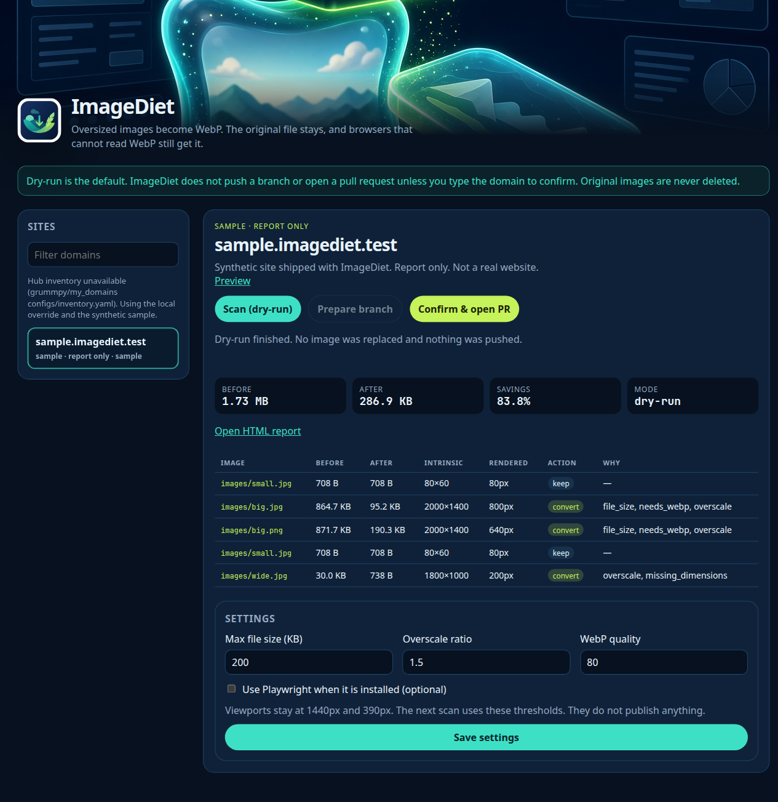

# ImageDiet


ImageDiet finds oversized images on a site, writes a WebP sibling next to each one, and patches HTML to a `<picture>` element so browsers without WebP still receive the original file. Originals are never deleted.

Dry-run is the default. A branch is pushed and a pull request is opened only after you type the site domain to confirm.


## Launch

The launchers create a virtualenv, install dependencies, serve the UI on `127.0.0.1:8766`, and open a browser. They require `art/icon.png` and `art/cover.png` and pass those files to the server.

- macOS: double-click `launch-mac.command`
- Windows: double-click `launch-windows.bat`
- Linux: `./launch-linux.sh`

```bash
python -m imagediet
```

The UI lists sites, runs a dry-run scan, shows the findings table, prepares a local branch, and asks you to type the domain before any push.



## Safety

- Scan is a dry-run. It writes `reports/<domain>/<timestamp>/report.md`, `report.json`, and `report.html`. It does not modify the site and it does not run git.
- Prepare clones the site repo into `work/`, creates `imagediet/<date>`, converts images, and commits locally. It does not push.
- Confirm & open PR stays closed until the typed domain matches the site. The CLI equivalent is `python -m imagediet confirm --domain example.com --confirm example.com`. Missing or mismatched `--confirm` exits without pushing.
- WebP files are written beside the originals (`photo.jpg` and `photo.webp`). An existing WebP is left alone. If the WebP would not be smaller, it is not written.
- HTML becomes `<picture><source type="image/webp" srcset="photo.webp"></picture>`.
- ImageDiet binds to `127.0.0.1` only. It does not change DNS or Hostinger settings.

## Site list

1. Primary: `configs/inventory.yaml` in `grummpy/my_domains`, read with `gh api` or the public raw URL. Fields are `domain`, optional `github_repo`, `status`, and `note`. A site with no `github_repo` is report-only.
2. Override: copy `config/sites.example.yaml` to `config/sites.yaml`.

```yaml
sites:
  - domain: example.com
    url: https://example.com
    github_repo: owner/repo
    branch_base: main
    image_root: .
```

Local entries win per domain. The bundled synthetic site `sample.imagediet.test` is always available when that domain is not already listed. `samples/testsite/` is generated data, not a live website.

## What a scan flags

- File size over `max_bytes` (default 200 KB).
- Intrinsic width greater than `ratio` (default 1.5) times the widest rendered width at 1440px and 390px, from HTML/CSS and `srcset` `sizes`. Playwright measurement is optional and off by default.
- JPEG/PNG over the size threshold that are not already WebP or AVIF.
- Missing `width` or `height` attributes.

Conversion uses Pillow WebP at quality 80, resizes to twice the max rendered width when that is known, keeps aspect ratio, and drops EXIF/GPS.

## Tests

Tests generate a local site (big JPEG, big PNG, already-small JPEG, high-resolution image displayed small in CSS), serve it on a random port, and never call a real site or repository.

```bash
python -m venv .venv
source .venv/bin/activate
python -m pip install -r requirements-dev.txt
pytest
```

## CLI

```bash
python -m imagediet scan --domain sample.imagediet.test
python -m imagediet prepare --domain example.com
python -m imagediet confirm --domain example.com --confirm example.com
```
